# ORound

Interactive water ripple experiments on the round 1.32" AMOLED of the
**Waveshare ESP32-S3-Touch-AMOLED-1.32**. Touch the screen to drop water;
drag to draw a trail of drops. Waves travel, reflect on the circular edge and fade.

The pool experiments (`drop1_16M_pool_*`) show the floor of a swimming pool: a tiled
grid or an image seen through the water surface, bent by the waves (refraction).

## Hardware

- Board: Waveshare ESP32-S3-Touch-AMOLED-1.32 (ESP32-S3-PICO-1-N8R8, 8 MB flash, 8 MB octal PSRAM)
- Display: 466x466 AMOLED, CO5300 controller, QSPI at 40 MHz, driven in RGB888 (24 bit)
- Touch: CST820 on I2C (address 0x15)
- Brightness (all experiments): hold a finger still for 0.8 s, then drag up (brighter) or down (darker) without lifting; the value is saved in NVS and restored at boot
- Buttons: BOOT (GPIO0) cycles the color palettes; PWR (GPIO17) toggles the microphone in `drop1_16M_pool_listening`, long press powers off in `drop1_16M_pool_tiles`; in `drop1_16M_pool_image` / `drop1_16M_pool_crystal` a short press toggles the microphone and a long press powers off (same in `empty2`, where BOOT has no action yet); in `life1_*` BOOT is a new seed (`life1_conway`) or the next tile size (`life1_penrose`, `life1_ts12`, `life1_ts1`, `life1_ts2`, `life1_ts3`, `life1_ts5`, `life1_ts6`, `life1_ts7`, `life1_ts9`, `life1_ts11`), the rosette spacing (`life1_ts8`), the lattice spacing (`life1_ts10`) or the next pentaflake level (`life1_ts4`), PWR long press powers off
- Docs: <https://docs.waveshare.com/ESP32-S3-Touch-AMOLED-1.32>

## Firmware experiments

Each experiment is a standalone ESP-IDF project under `firmware/`.

| Folder | Description |
|---|---|
| `drop1_65k` | Direct panel driver (no LVGL), 2D wave equation, slope shading, RGB565 |
| `drop1_16M` | Same in RGB888 (16.7M colors), radial background with ordered dither |
| `drop1_16M_multipalette` | Each tap gets a random crest tint carried by a second wave field; 7 palettes on BOOT/PWR |
| `drop1_16M_grid2x2` | Finer simulation grid (1 cell = 2x2 px), int16 fields, precomputed ring map |
| `drop1_16M_grid2x2_pie` | Wave step in fixed point with ESP32-S3 PIE vector instructions (8 x int16 per instruction) |
| `drop1_16M_pool_tiles` | Pool floor grid deformed by refraction, with tiles in slightly different azure shades (azure palette); long press PWR powers off (battery) or deep sleeps (USB) |
| `drop1_16M_pool_image` | Pool floor from an image: coverage mask drawn with the palette, full color image, or animated GIF (frames switched in time); microphone ripples |
| `drop1_16M_pool_crystal` | Frozen copy of `drop1_16M_pool_image` with a rotating crystal animation on a dark green background (`--anim --step=2 --bg=198919`, 466 px); wider drops and lit crests so waves show on the uniform background |
| `drop1_16M_pool_image_bufalini` | Frozen copy of `drop1_16M_pool_image` with a full color photo as floor (`--rgb`, 514 px; third-party artwork by Paolo Bufalini, `floor.bin` not in the repository); microphone with fixed reference (-55 dBFS, first drop at ~-52 dBFS, background adaptation commented out) |
| `drop1_16M_pool_listening` | Pool floor grid deformed by refraction (4 palettes, ~20 fps) that listens: microphone (ES8311) sound level ripples the water with small random drops; PWR toggles the microphone |
| `empty2` | Empty skeleton for new experiments: solid background, touch, microphone, brightness control; PWR short press toggles the microphone, long press powers off; BOOT free for a new use |
| `life1_conway` | Conway's Game of Life, 20 px cells (23x23 grid) inside the circle, one generation every 3 s; each changing cell fades its color (two-stage filter, slow start and end, ~3 s) starting in a random one of 10 time slots (300 ms apart); newborn orange turning blue with age; touch adds cells, BOOT new seed, automatic new seed on still or empty states; no microphone, PWR long press powers off |
| `life1_penrose` | Game of Life (B3/S23) on a Penrose rhombus tiling (P3) built on the device by deflation; neighbors = tiles sharing a vertex (4..11); tiles without gap, two dark shades for thin/thick rhombi, black border from 18 px; BOOT cycles the tile edge (8, 11, 14, 18, 24, 32, 40, 48, 56, 64 px, shown on the serial log); generation 4 s and fade time constant 1.1 s up to 14 px, longer for larger tiles (x2.4 at 48 px); live colors by age orange, yellow, bright green; no microphone |
| `life1_ts1` | Variant of `life1_penrose` on an Alhambra arrow tiling (from `data/tassel/Alhambra.jpg`): square grid, one arrow per grid edge, vertical arrows with the tip on even points, horizontal ones on odd points; built on the device, 8 vertex neighbors per tile; two dark shades for vertical/horizontal arrows, black border from 24 px; BOOT cycles the arrow length (12, 16, 20, 24, 28, 32, 40, 48, 64, 80 px); generation 4 s and fade time constant 1.1 s up to 20 px, longer for larger tiles (x2.3 at 64 px); no microphone |
| `life1_ts2` | Variant of `life1_penrose` on a Cairo pentagon tiling (from `data/tassel/irreguralPent.png`): pairs of pentagons sharing the short edge on a square lattice, vertical and horizontal pairs alternating; all vertices on integer grid units; 7 vertex neighbors per tile; two dark shades for vertical/horizontal pairs, black border from 16 px; BOOT cycles the short edge (8, 10, 12, 14, 16, 20, 24, 32, 40, 48 px); generation 4 s and fade time constant 1.1 s up to 12 px, longer for larger tiles (x2.4 at 40 px); no microphone |
| `life1_ts3` | Variant of `life1_penrose` on a tiling of regular hexagons and 60 degree rhombi (from `data/tassel/hex2.webp`): flat-top hexagons in columns touching at the side vertices, rhombi in the gaps between columns; vertex neighbors 8 for hexagons, 6 for rhombi; dead colors: two shades for the hexagon checkerboard, gray blue for rhombi; black border from 12 px; BOOT cycles the hexagon side (6, 8, 10, 12, 14, 16, 20, 24, 32, 40 px); generation 4 s and fade time constant 1.1 s up to 10 px, longer for larger tiles (x2.8 at 40 px); no microphone |
| `life1_ts4` | Game of Life on a pentaflake (Dürer pentagon fractal, from `data/tassel/penta1.webp`): regular pentagons touching only at vertices, plus the thin rhombi (36 degrees) closed by four pentagon edges as cells; the star shaped and open gaps stay black; built on the device recursively (central flake rotated 36 degrees plus five copies toward the tips, scale 1 / (1 + golden ratio)); 3..10 neighbors per pentagon, 6 per rhombus, rule B2/S23 (B3/S23 freezes within about 15 generations); two dark shades by pentagon orientation, gray blue rhombi; BOOT cycles the level 3, 4, 2 (pentagon side 15.3, 5.8, 40 px; 216 + 40, 1296 + 260, 36 + 5 tiles); generation 4 s up to 16 px; no microphone |
| `life1_ts5` | Game of Life (B3/S23) on regular pointy-top hexagons with striped fills (from `data/tassel/hexagon_dahs.jpg`): every hexagon is filled with stripes (7.5 per hexagon width, dark gaps) whose angle grows by 30 degrees per hexagon to the right, and gets darker toward the top; a per-pixel shade map (8 levels) multiplies the cell color; 6 neighbors per tile; dead cells gray; black border from 10 px; BOOT cycles the hexagon side (6, 8, 10, 12, 14, 16, 20, 24, 32, 40 px); generation 4 s up to 10 px, longer for larger tiles; no microphone |
| `life1_ts6` | Game of Life on the isometric tiling of `data/tassel/fake_3d1.jpg` (3D look): red, white and blue L pieces (10 triangles) and gray parallelograms (4 triangles) on a grid of equilateral triangles, period lattice (-5, 3), (4, 6) found from the image; 11 neighbors per L piece, 9 per parallelogram, so the rule is B3/S234 (B3/S23 dies out within 30..90 generations); dead cells only in blue and gray tones, no black border between tiles, live colors scaled per kind (white 1.0, red 0.85, blue 0.7, gray 0.55) to keep the 3D look; BOOT cycles the rhombus side (6, 8, 10, 12, 14, 16, 20, 24, 32, 40 px); no microphone |
| `life1_ts7` | Game of Life on an isometric tiling designed from `data/tassel/fake_3d2.jpg`: the image repeats the L pinwheel of `fake_3d1` and closes it with cubes, which do not fit the `fake_3d1` period; an exact cover search found a period (lattice (-5, 3), (-2, -12), 66 triangles) with three L pieces, one cube (three rhombi of side 2) and three gray parallelograms; mostly 5..6 neighbors, rule B2/S23 (B3/S23 freezes within 15..26 generations); dead cells only blue and gray tones, live colors scaled per color (white 1.0, magenta 0.85, blue 0.7, gray 0.55); no black border; BOOT cycles the rhombus side (6..40 px); no microphone |
| `life1_ts8` | Game of Life (B3/S23) on an arabesque tiling measured from `data/tassel/arabesque-arabic.jpg`: rosettes on a hexagonal lattice, all lines at 30/90/150 degrees at distances r, 2r, D/2 from the nearest rosette center (r = 0.181 D); vertices from the line intersections, completed by 6-fold symmetry; 21 tiles per period (central hexagon, 6 star triangles, 6 parallelograms, 6 trapezoids, 2 small hexagons), area check exact; neighbors 6..12 with a 0.05 px vertex tolerance; black lines 3.4 px as in the image; dead cells blue and gray tones; BOOT cycles the rosette spacing (48..330 px, default 96); no microphone |
| `life1_ts9` | Game of Life (B3/S23) on the isometric tiling of `data/tassel/fake-3d4.jpg` (3D look in three shades): white, light gray and dark gray L pieces (10 triangles) and single rhombi (2 triangles), period lattice (5, 3), (-4, 6) (mirror of `fake_3d1`), 9 tiles per period; 8 neighbors per L piece, 7 per rhombus; dead cells only blue and gray tones, live colors scaled per shade (1.0, 0.8, 0.6); no black border; BOOT cycles the rhombus side (6..40 px, default 14); no microphone |
| `life1_ts10` | Game of Life (B3/S23) on the curved tiles of `data/tassel/hexTongue.jpg` (the hexagon is only a frame): one tile shape with 180 degree symmetry, averaged over the 12 complete tiles of the image, in three orientations 120 degrees apart on a hexagonal lattice; outline of 60 points; neighbors = outlines closer than 1/10 of the spacing (4 along the sides + 6 around the small holes at the swirl points = 10, as in the image); pixel map with 2 fill passes, no black line between tiles; dead cells blue and gray tones; BOOT cycles the lattice spacing (24..140 px, default 37; build about 4 s); no microphone |
| `life1_ts11` | Game of Life (B2/S23) on the isometric tiling of `data/tassel/fake_3d5.jpg` (3D look, three grays and white, no outlines: tiles = same-color regions): rhombic frames with a hole (outer and inner outline joined by a zero-width cut), small pieces of 3 and 5 triangles and white triangles; period lattice (0, 10), (15, 5) on a grid with horizontal sides, 21 tiles per period; T-junction points added as vertices so tiles touching along a side share vertices; neighbors 3 (triangles), 5 (pieces), 16 (frames); dead cells blue and gray, live colors scaled per shade; no black border; BOOT cycles the triangle side (6..40 px, default 12); no microphone |
| `life1_ts12` | Game of Life (B3/S23) on a Penrose kite and dart tiling (P2), recognized in `data/tassel/darts_and_kites_ii.png` from the tile angles; built on the device by deflation of half kites and half darts from a sun of 5 kites placed at a random point up to 3 display radii from the center (another part of the non periodic tiling at every boot and BOOT) (rules found by testing the 64 variants of split position and half orientation: the only ones where all halves pair into kites and darts), halves paired on their axis; 425 tiles at 28 px long edge, neighbors 4..10; non-convex darts rasterized with the crossing test; black border from 18 px; dead cells two blue tones; BOOT cycles the long edge (12..80 px); no microphone |

### Game of Life previews

| `life1_conway` | `life1_penrose` | `life1_ts1` | `life1_ts2` | `life1_ts3` | `life1_ts4` | `life1_ts5` | `life1_ts6` | `life1_ts7` | `life1_ts8` | `life1_ts9` | `life1_ts10` | `life1_ts11` | `life1_ts12` |
|---|---|---|---|---|---|---|---|---|---|---|---|---|---|
| 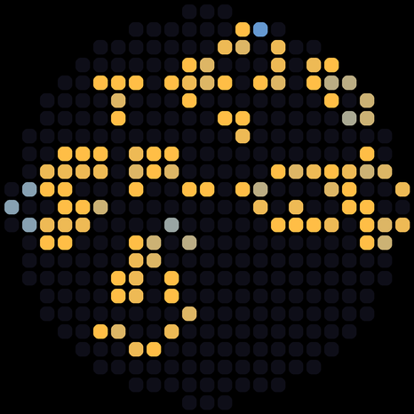 | 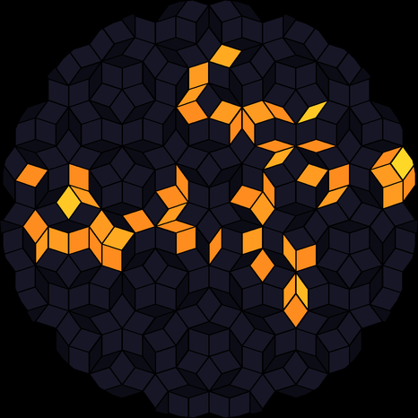 | 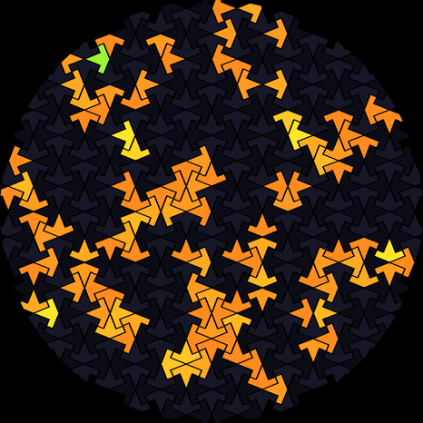 | 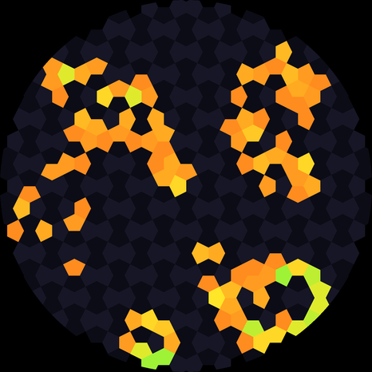 | 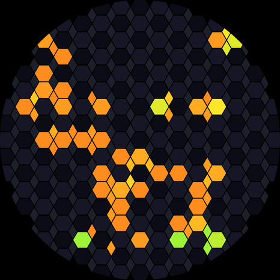 | 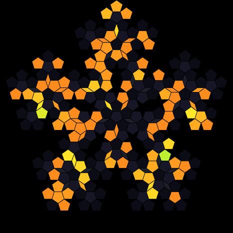 | 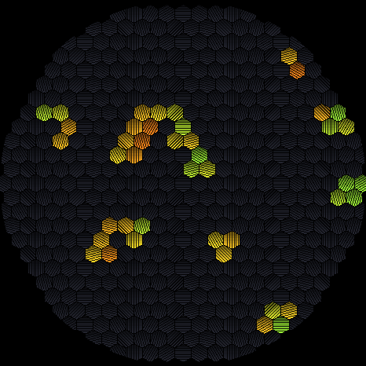 | 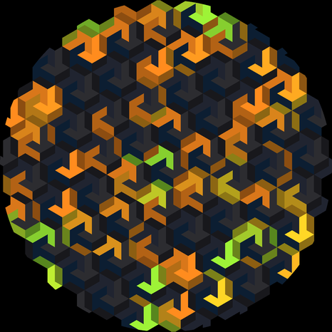 | 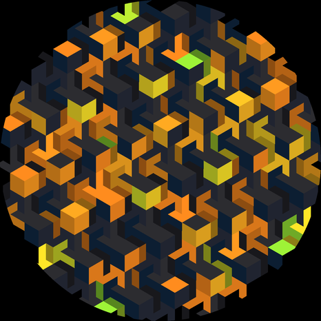 | 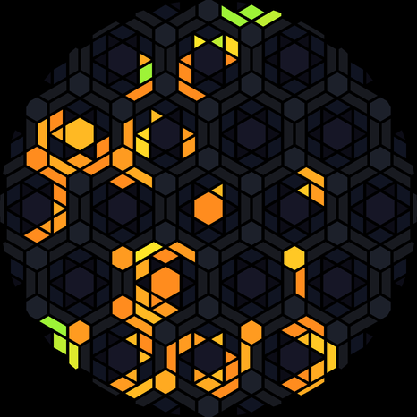 | 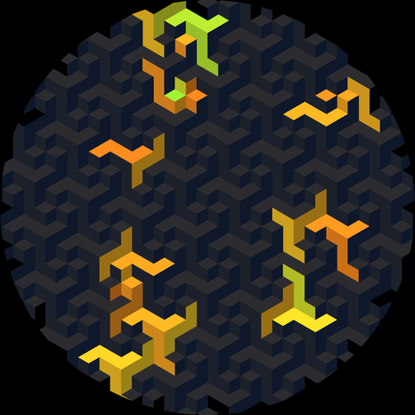 | 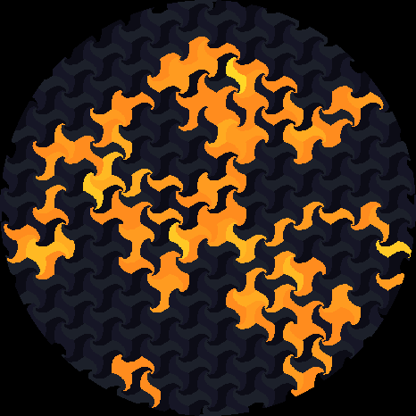 | 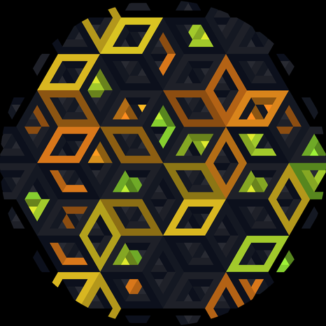 | 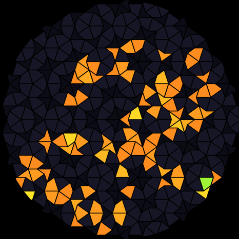 |

Made with `python scripts/make_life_previews.py` (same geometry and colors as the firmware,
state after 9 generations from a random seed; default cell sizes 20, 24, 28, 14, 16, 15.3, 12, 12, 12, 96 (rosette spacing), 14, 37 (lattice spacing), 12 and 28 px: average cell side about 20 px, i.e. square root of the mean cell area).

Each `firmware/life1_*` folder has an `info/` folder with `preview.png` (display preview), `tiles.png`
(the tile shapes, separated, green on black, with sizes and neighbors; `python scripts/make_life_info.py`)
and `regole.md` (complete rules in Italian: tiling construction, transitions, colors, fades, controls).

### Microphone

In `drop1_16M_pool_listening`, `drop1_16M_pool_image` and `drop1_16M_pool_crystal` the
ES8311 records 16 kHz mono with 30 dB gain; the RMS level of each 16 ms block is compared
with an estimate of the background noise. The estimate is clamped to -40..-20 dBFS:
in a quiet room the first drop comes at about -33 dBFS, and in loud places continuous
noise raises the reference only up to -20 dBFS, so sounds still make drops.
The serial log prints peak, background and reference level every 2 s.

### How the simulation works

- Height field on a 236x236 grid (1 cell = 2x2 pixels), two buffers (current, previous).
- Wave equation with viscosity and damping, written as one weighted sum per cell:
  `new = cc*c + cp*p + cs*(left + right + up + down)` with Q15 coefficients.
- The step runs in `wave_pie.S` with PIE instructions on both cores (rows split in two halves);
  a boot self test compares it with a scalar C reference.
- Cells outside the circle stay 0, so waves reflect on the round edge.
- Rendering: bilinear interpolation of the per-cell slope to every pixel. In the pool
  version each pixel samples the grid at its position shifted by the local slope
  (x and y separately, 1/16 px resolution). Grid lines have a full core plus soft edges
  blended in emitted light (gamma 2.2).
- In the image and animation floors the slope also shades the water: slopes facing the
  light (top left) mix toward a light green, the opposite slopes darken.
- The frame is sent in bands of 16 lines with two DMA buffers; both cores render half of each band.

## Build and flash

Requires ESP-IDF v5.5. Adjust the paths in `scripts/idf_env.sh` to your installation.

```
scripts/build.sh firmware/drop1_16M_pool_listening
scripts/flash.sh firmware/drop1_16M_pool_listening            # first /dev/cu.usbmodem* port
scripts/flash.sh firmware/drop1_16M_pool_listening <port> --monitor
```

The serial log prints frames per second and the time of the simulation step and of the render every 2 s.

### Pool floor images

`drop1_16M_pool_image` and `drop1_16M_pool_crystal` embed `main/floor.bin`, produced by
`scripts/make_mask.py` (Pillow, run in the project `.venv`). The file is not in the
repository (third-party images). Without it the build uses the placeholder
`assets/floor_placeholder.bin` (coverage mask made from `assets/PH.png`, 480 px); the
check runs again when `floor.bin` is added or removed. Generate your own, for example:

```
python scripts/make_mask.py assets/PH.png assets/floor_placeholder.bin 480   # the placeholder
python scripts/make_mask.py figure.png firmware/drop1_16M_pool_image/main/floor.bin 400
python scripts/make_mask.py photo.jpg  firmware/drop1_16M_pool_image/main/floor.bin 514 --rgb --crop=x0,y0,x1,y1
python scripts/make_mask.py anim.gif   firmware/drop1_16M_pool_image/main/floor.bin 466 --anim --step=2 --bg=23c423
```

The firmware detects the mode from the file: coverage mask (514x514 bytes), RGB888 image
(514x514x3 bytes) or animation (`FLA2` header, indexed frames, shared palette).

## License

- Code: GPL-3.0-or-later
- Image (including `assets/PH.png` and `assets/floor_placeholder.bin`): CC BY-SA 4.0

## Author

ghedo (luca.ghedini@gmail.com) — 2026

Built with Claude Code by Anthropic.

## Development effort

Figures extracted from the local Claude Code session transcripts of this project.

| Metric | Value |
|---|---|
| First message (UTC) | 2026-10-16 19:12 |
| Last message (UTC) | 2026-10-20 21:02 |
| Calendar span | 5 days |
| Commits | 28 |
| Sessions | 5 |
| Messages (user + assistant) | 1123 (183 + 940) |
| Active time | ~8.29 h |

Active time is the sum of the gaps between consecutive messages (user and assistant,
sorted by timestamp) that are at most 5 minutes long. Longer gaps are treated as pauses
and not counted, so the value approximates the time spent actively working, including
build and flash waits shorter than 5 minutes.

| Tokens | Count |
|---|---|
| Input (non-cache) | 1,880 |
| Output | 871,354 |
| Cache write | 2,089,730 |
| Cache read | 223,920,052 |
| Total | 226,883,016 |

Cache read tokens are the conversation context re-sent to the model at every turn and
served from the prompt cache; they are by far the largest share but are billed at a
fraction of the normal input price.

**Caveman mode.** All five sessions ran with Caveman mode active (terse responses).
Average output was 927 tokens per assistant message (871,354 output tokens in total).
No session without Caveman mode exists in this project, so no comparison with
standard mode is available.
