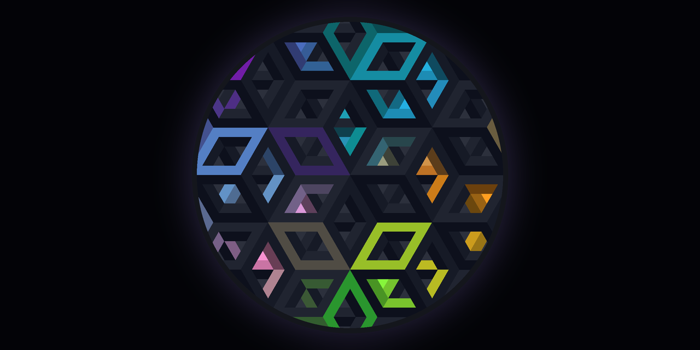

# ORound



Experiments on the round 1.32" AMOLED of the **Waveshare ESP32-S3-Touch-AMOLED-1.32**,
in three series. Each experiment is a standalone ESP-IDF project under `firmware/`;
each series has its own page with the full description, controls and previews.

| Series | Page | Content |
|---|---|---|
| Water ripples | [docs/drop.md](docs/drop.md) | `drop1_*`, `empty2`: touch drops water, waves reflect on the round edge; pool floor (tiles, image, animation) bent by refraction; microphone ripples |
| Game of Life | [docs/life.md](docs/life.md) | `life1_*`, `lifeAllStart`: Life on square cells and on 13 tilings built on the device (Penrose, Alhambra, Cairo, isometric, arabesque, curved tiles, kites and darts) |
| Fire | [docs/flame.md](docs/flame.md) | `flame1_*`: PSX Doom fire, linear and radial; the radial fire moves to the tap point, changes palette (also palettes from the Xong logo colors) and reacts to blowing on the microphone; a black and white version with welding sparks, explosions and back-and-forth rotation |

## Hardware

- Board: Waveshare ESP32-S3-Touch-AMOLED-1.32 (ESP32-S3-PICO-1-N8R8, 8 MB flash, 8 MB octal PSRAM)
- Display: 466x466 AMOLED, CO5300 controller, QSPI at 40 MHz, driven in RGB888 (24 bit)
- Touch: CST820 on I2C (address 0x15)
- Audio: ES8311 codec on the same I2C bus (address 0x18), microphone input only; no motion sensor on the board
- Buttons: BOOT (GPIO0) and PWR (GPIO17); their use per experiment is on the series pages
- Brightness (all experiments): hold a finger still for 0.8 s, then drag up (brighter) or down (darker) without lifting; the value is saved in NVS and restored at boot
- Docs: <https://docs.waveshare.com/ESP32-S3-Touch-AMOLED-1.32>

## Build and flash

Requires ESP-IDF v5.5. Adjust the paths in `scripts/idf_env.sh` to your installation.

```
scripts/build.sh firmware/drop1_16M_pool_listening
scripts/flash.sh firmware/drop1_16M_pool_listening            # first /dev/cu.usbmodem* port
scripts/flash.sh firmware/drop1_16M_pool_listening <port> --monitor
```

The serial log prints frames per second and the time of the simulation step and of the render every 2 s.
For the pool floor images of `drop1_16M_pool_image` and `drop1_16M_pool_crystal` see [docs/drop.md](docs/drop.md#pool-floor-images).

## License

- Code: GPL-3.0-or-later
- Image (including `assets/PH.png`, `assets/floor_placeholder.bin` and `assets/cover.png`): CC BY-SA 4.0

## Author

ghedo (luca.ghedini@gmail.com) — 2026

Built with Claude Code by Anthropic.

## Development effort

Figures extracted from the local Claude Code session transcripts of this project.

| Metric | Value |
|---|---|
| First message (UTC) | 2026-10-16 19:12 |
| Last message (UTC) | 2026-11-01 21:15 |
| Calendar span | 17 days |
| Commits | 38 |
| Sessions | 9 |
| Messages (user + assistant) | 1569 (277 + 1292) |
| Active time | ~11.31 h |

Active time is the sum of the gaps between consecutive messages (user and assistant,
sorted by timestamp) that are at most 5 minutes long. Longer gaps are treated as pauses
and not counted, so the value approximates the time spent actively working, including
build and flash waits shorter than 5 minutes.

| Tokens | Count |
|---|---|
| Input (non-cache) | 2,582 |
| Output | 1,096,995 |
| Cache write | 2,779,146 |
| Cache read | 272,288,084 |
| Total | 276,166,807 |

Cache read tokens are the conversation context re-sent to the model at every turn and
served from the prompt cache; they are by far the largest share but are billed at a
fraction of the normal input price.

**Caveman mode.** All nine sessions ran with Caveman mode active (terse responses).
Average output was 849 tokens per assistant message (1,096,995 output tokens in total).
No session without Caveman mode exists in this project, so no comparison with
standard mode is available.
