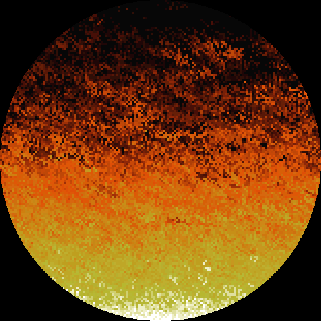
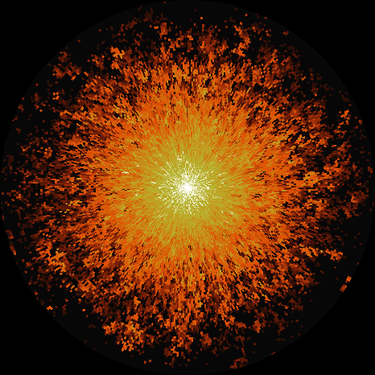
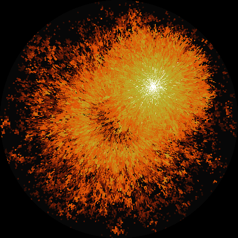
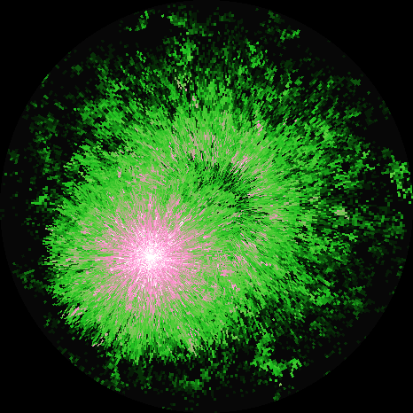
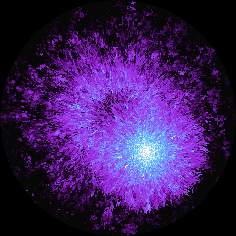
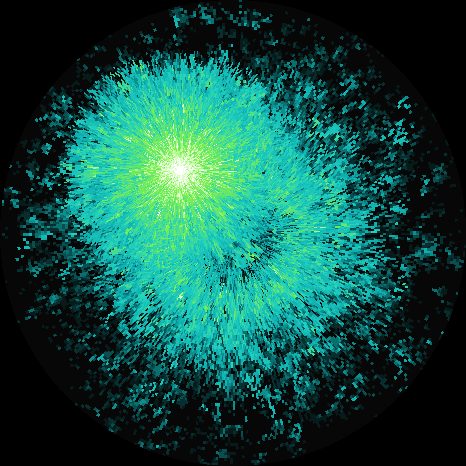

# Fire series (`flame1_*`)

Fire of the PSX Doom title screen (algorithm as described by Fabien Sanglard), first
on a square grid, then on a polar grid with the fire spreading from a point, moved
by touch and modulated by blowing on the microphone.

Back to the [main README](../README.md).

## Experiments

| Folder | Description |
|---|---|
| `flame1_doom` | Grid of intensities 0..36 shown with the 37 color Doom fire palette, bottom row = 36; at each step every cell is copied one row up, shifted by -2..+1 columns, black propagates straight up; 27 steps/s; one cell = 3x3 px by default (grid 156x156), BOOT cycles 1/2/3/4/5/6/8 px (saved in NVS); the decay probability per row is set from the grid height, so the flames reach about 70% of the display height at every scale; tap toggles the source (off: the bottom row dies down as at the end of the PSX intro), taps within 0.6 s of a BOOT press are ignored (pressing BOOT touches the panel); about 25 fps |
| `flame1_doom_rad` | Radial version: polar grid (columns = angles, rows = radii), the center is the source and "one row up" is one cell outward; a lookup table maps every display pixel to its cell (rebuilt at each scale change, 0.4 s); cell size = scale px along the radius and at the display edge along the angle; lateral shift -1, 0, 0, +1 (symmetric, no swirl); mean loss per row m = 36 / (0.7 x radii), applied as k levels with probability m / k (k = smallest integer >= 2m) so the texture stays random when m >= 1; speed 81 px/s at every scale (steps per second = 81 / scale); between two steps the image is drawn shifted outward by 0, 1/4, 1/2, 3/4 of a cell (shift ramps from 0 at the center to full at 4 cells, so the source disk does not pulse); the column processing order starts at a random column each step (no seam on one angle); BOOT cycles 2/3/4/5/6/8/10 px, always 3 px at boot; microphone wind (see below); serial commands '1'..'7' (scale), 'n' (next scale), 't' (source on/off); about 17..20 fps at 3 px |
| `flame1_doom_rad_mv` | `flame1_doom_rad` with a movable fire: a tap moves the fire to the tap point (the current fire's source goes off and it dies down in about 4 s while a new one starts; a third tap drops the dying one); one lookup table of offsets from a fire center serves any position; two fires drawn as the maximum of the two intensities; 4 palettes on PWR short press (Doom orange / yellow, green / pink, purple / light blue, turquoise / green, defined by color stops); PWR double click moves the fire back to the center; PWR polled every 10 ms in its own task (double click gap 0.3 s); 17..19 fps with one fire, 10..13 fps while two fires are drawn |

## Buttons and touch

| Control | `flame1_doom` | `flame1_doom_rad` | `flame1_doom_rad_mv` |
|---|---|---|---|
| BOOT | next pixel scale | next pixel scale | next pixel scale |
| PWR short press | - | - | next palette |
| PWR double click | - | - | fire back to the center |
| PWR long press (1.5 s) | power off | power off | power off |
| Tap | source on/off | source on/off | move the fire |
| Hold still 0.8 s, drag | brightness | brightness | brightness |

## Wind from the microphone

`flame1_doom_rad` and `flame1_doom_rad_mv` read the ES8311 microphone level (0..1 above
the background noise, as in the `drop1_*` series) and smooth it (immediate rise, fall
with a 0.6 s time constant). With one microphone only the strength of the blow is
known, not its direction.

| Level | Effect |
|---|---|
| above 0.10 | agitation: lateral shift up to -3..+3 columns and more irregular decay (same mean), full at 0.40 |
| above 0.30 | lower: mean decay up to x4 (flames 1/4 long) at 0.80 |
| above 0.85 for 0.5 s | blown out: the source goes off; it relights after 3 s below 0.08 (or with a tap) |

The serial log prints `wind` every 2 s and `blown out` / `relit`.

## Previews

| `flame1_doom` | `flame1_doom_rad` |
|---|---|
|  |  |

`flame1_doom_rad_mv` (fire moved off the center, the previous one dying at the center), one per palette:

| Doom | green / pink | purple / light blue | turquoise / green |
|---|---|---|---|
|  |  |  |  |

Made with `python scripts/make_flame_previews.py` (same algorithm, palettes and default
3 px scale as the firmware, 300 steps; the step is vectorized per row and the sub-cell
shift is not drawn).
